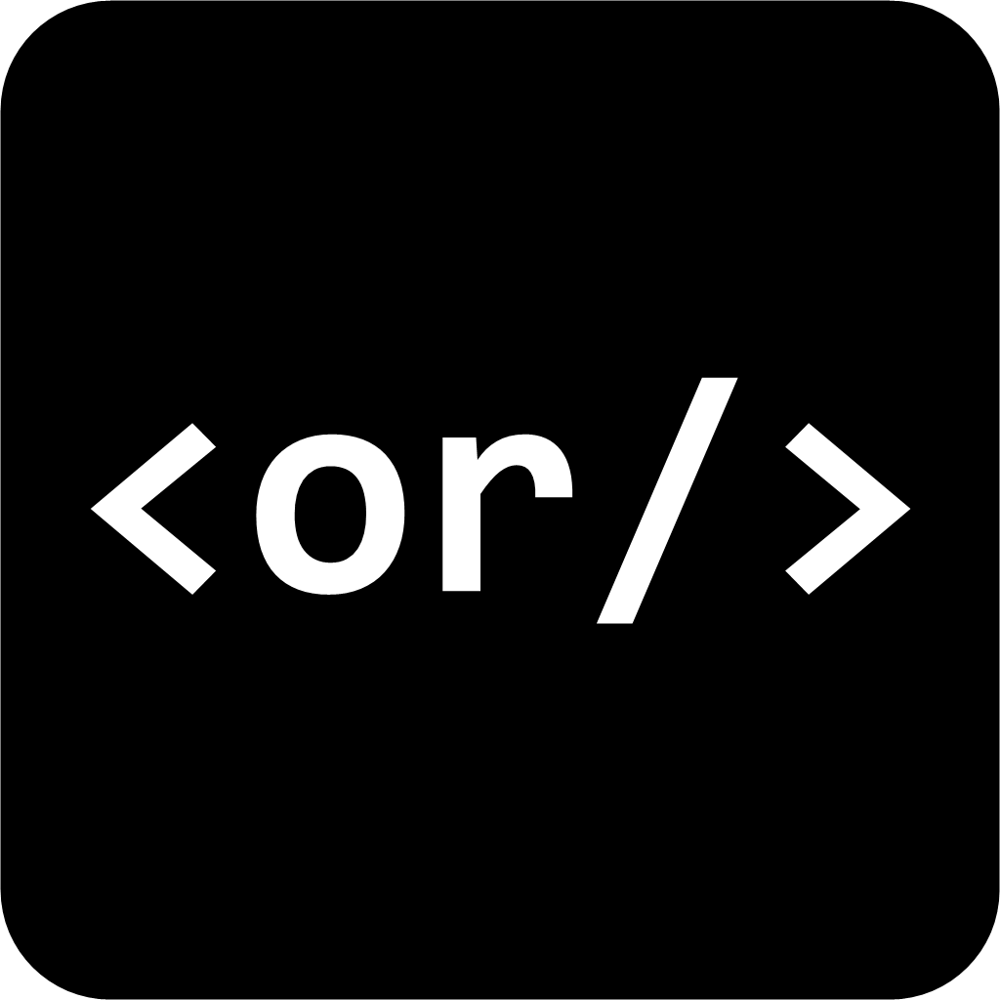

   
  <b style="font-size: 28px">CordDesk</b> 
  Fast, secure remote desktop for Windows and Mac

  <a href="https://github.com/24hragency-dev/corddesk/releases/latest/download/CordDesk.exe"><b>Download for Windows</b></a> •
  <a href="https://github.com/24hragency-dev/corddesk/releases/latest/download/CordDesk-Mac-AppleSilicon.dmg"><b>Mac (Apple Silicon)</b></a> •
  <a href="https://github.com/24hragency-dev/corddesk/releases/latest/download/CordDesk-Mac-Intel.dmg"><b>Mac (Intel)</b></a>

---

## Download

| Platform | Download |
|---|---|
| Windows 10 / 11 (64-bit) | [CordDesk.exe](https://github.com/24hragency-dev/corddesk/releases/latest/download/CordDesk.exe) |
| Mac with Apple Silicon (M1 / M2 / M3 / M4) | [CordDesk-Mac-AppleSilicon.dmg](https://github.com/24hragency-dev/corddesk/releases/latest/download/CordDesk-Mac-AppleSilicon.dmg) |
| Mac with Intel processor | [CordDesk-Mac-Intel.dmg](https://github.com/24hragency-dev/corddesk/releases/latest/download/CordDesk-Mac-Intel.dmg) |

All versions: [Releases](https://github.com/24hragency-dev/corddesk/releases)

## Getting started

**Windows**

1. Run `CordDesk.exe`. If Windows shows *"Windows protected your PC"*, click **More info → Run anyway**.
2. Click **Install CordDesk** so it starts with Windows and works for unattended access.
3. Share your **ID** and **password** with the person who will connect, or enter their ID and click **Connect**.

**Mac**

1. Open the `.dmg` and drag **CordDesk** into **Applications**.
2. The first time, right-click **CordDesk → Open** (the app is not signed with an Apple developer certificate yet).
3. When asked, allow **Screen Recording** and **Accessibility** in *System Settings → Privacy & Security*, so the other side can see and control the screen.

## Features

- Connect by a 9-digit ID — no port forwarding or VPN needed
- End-to-end encrypted connections through the CordDesk server
- Direct peer-to-peer connections whenever the network allows, for low latency
- Unattended access with a permanent password
- File transfer, clipboard sync, chat and multi-monitor support
- Windows and macOS

## Support

Website: [24hragency.com](https://24hragency.com)

## License

CordDesk is open-source software licensed under the [GNU AGPL-3.0](LICENSE).
